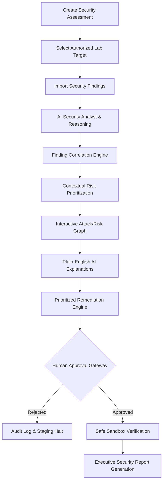

# CyberMind AI — Intelligent Cybersecurity Assessment Platform
*Built for the **DataOps Innovation Hackathon 2026***

> **"Think Beyond Automation. Understand Security."**
>
> *"CyberMind AI doesn't just find security issues. It understands how those issues relate to each other, evaluates their contextual risk, explains why they matter, recommends what to fix first, and keeps humans in control of security actions."*

---

## 1. Problem
Modern vulnerability scanners (Nmap, OWASP ZAP, Burp Suite, Nessus) generate hundreds of isolated findings with static severity scores (e.g., CVSS). Security teams face:
- **Alert Fatigue & Isolation:** A "Medium" finding like an exposed admin panel and a "High" finding like missing brute force protection are reported independently, masking the reality that together they yield a **Critical compromise path**.
- **Lack of Contextual Exploitability:** Vulnerability severities do not account for asset importance, exposure (external vs internal), or attack chains.
- **Unsafe Autonomous Actions:** Unconstrained security automation risks damaging production systems or violating authorization boundaries.

---

## 2. Solution: CyberMind AI
CyberMind AI transforms raw, disconnected vulnerability observations into correlated, contextual security intelligence.
1. **Context-Aware Risk Scoring:** Re-evaluates raw technical severities against exposure, exploitability, asset importance, and correlation factor.
2. **Finding Correlation Engine:** Discovers multi-step attack graphs where chaining low-to-medium findings creates critical business impact.
3. **Explainable AI:** Provides clear, non-expert explanations of WHY a risk was elevated and why certain fixes must come first.
4. **Human-in-the-Loop Gateway:** Enforces human review before any active security action, restricted strictly to authorized sandbox environments.
5. **Actionable Remediation:** Outputs prioritized fix plans with copyable hardening configurations, rollback steps, and executive-ready reports.

---

## 3. Architecture & User Workflow



---

## 4. System Architecture

```text
┌────────────────────────────────────────────────────────────────────────┐
│                          CYBERMIND AI CLIENT                           │
│  React 19 • TypeScript • Tailwind CSS • Canvas/SVG Risk Graph          │
│  Dashboard • Findings • AI Analysis • Recommendations • Approval Center│
└───────────────────────────────────┬────────────────────────────────────┘
                                    │ HTTP / JSON API
┌───────────────────────────────────▼────────────────────────────────────┐
│                       FULL-STACK EXPRESS BACKEND                       │
│  server.ts • REST API Routes • Vite Dev Middleware                     │
│  - /api/assessments & /api/findings                                    │
│  - /api/ai/analyze (Gemini 3.8 Flash Contextual Reasoning)             │
│  - /api/ai/chat (Grounded Security Assistant Copilot)                  │
│  - /api/actions/request & /api/actions/review (Safety Guardrails)       │
│  - /api/audit-logs (Immutable Chronological Audit Trail)               │
└───────────────────────────────────┬────────────────────────────────────┘
                                    │
┌───────────────────────────────────▼────────────────────────────────────┐
│                    GOOGLE GEMINI 3.8 FLASH ENGINE                      │
│  @google/genai SDK (Server-Side) • JSON Structured Output Schema       │
│  Multi-Vector Correlation • Plain English Rationale • Mitigation Code  │
└────────────────────────────────────────────────────────────────────────┘
```

---

## 5. Key Innovations for DataOps 2026

1. **Context-Aware Risk Analysis:** Evaluates exposure, exploitability, asset importance, and confidence rather than blindly copying scanner CVSS ratings.
2. **Finding Correlation:** Multi-node relationship graphs linking assets, services, vulnerabilities, and business impact.
3. **Explainable AI:** Plain-English explanations suitable for executives and non-technical stakeholders explaining why a finding matters.
4. **Human-in-the-Loop Security:** Active security verification requires mandatory human sign-off; forbidden actions (brute force, malware, destructive scripts) are rejected by policy.
5. **Automated Security Intelligence:** Translates raw scanner exports (JSON/CSV) into executive summaries, hardening code, and 13-section audit reports.

---

## 6. Safety & Non-Destructive Principles

- **Authorized Lab Targets Only:** Enforces strict whitelist validation against authorized sandbox environments (`LAB-WEB-01`, `LAB-CORP-AD`, `LAB-CLOUD-K8S`).
- **No Arbitrary Internet Scanning:** Network actions are bound to isolated test subnets.
- **Forbidden Actions Rejected:** Pre-flight policy checks reject credential dictionary attacks, malware deployment, persistence, and destructive commands (`rm -rf`, `drop table`).
- **Audit Logging:** Every observation, AI run, human approval, rejection, and blocked policy violation is permanently recorded in the audit trail.

---

## 7. Technology Stack

- **Frontend:** React 19, TypeScript, Tailwind CSS v4, Lucide Icons, Canvas-Confetti
- **Backend:** Node.js, Express, tsx
- **AI Engine:** Google Gemini API (`gemini-3.8-flash` via `@google/genai`)
- **Visualizations:** Custom Interactive SVG/Canvas Risk Graph with pan/zoom, node dragging, and attack path highlighting

---

## 8. Environment Variables

Create `.env` using `.env.example`:

```bash
# GEMINI_API_KEY: Required for Gemini AI API calls.
# AI Studio automatically injects this at runtime from user secrets.
GEMINI_API_KEY="YOUR_GEMINI_API_KEY"

# APP_URL: The URL where this applet is hosted.
APP_URL="http://localhost:3000"
```

---

## 9. Installation & Running Locally

```bash
# 1. Install dependencies
npm install

# 2. Run the full-stack development server (Express + Vite on Port 3000)
npm run dev

# 3. Build for production
npm run build
npm run start
```

---

## 10. Demo Scenario (Judge Walkthrough)

To immediately experience the platform during evaluation:
1. Click **"Try Demo"** in the top navigation or on the landing page.
2. Target **`LAB-WEB-01`** is loaded with 8 observed findings.
3. Observe the **Overall Security Score (68/100)** and the **AI Risk Correlation Summary**:
   > *"3 findings appear to be connected and form an exploitable high-risk security path: Exposed Administrative Interface + Weak Authentication + Outdated Web Service creates a direct administrative compromise vector."*
4. Navigate to **Risk Graph** and select **"Highlight Chain 1: Admin Takeover"** to see the interactive attack path ignite across Assets -> Services -> Findings -> Risks -> Business Impact.
5. Go to **AI Analysis** to view the Contextual Risk Scoring Matrix comparing technical vs final risk.
6. Open **Approval Center** to review a pending active verification request and approve it with sign-off notes.
7. Open **AI Copilot** (bottom right) and click prompt chips such as *"Why is this finding Critical?"* or *"Which finding should I fix first?"*.
8. Navigate to **Reports** to review and print the formal 13-section audit document.

---

## 11. Hackathon Team & Scope
- **Event:** DataOps Innovation Hackathon 2026
- **Track:** Intelligent Cybersecurity & Automated SecOps
- **Project:** CyberMind AI
